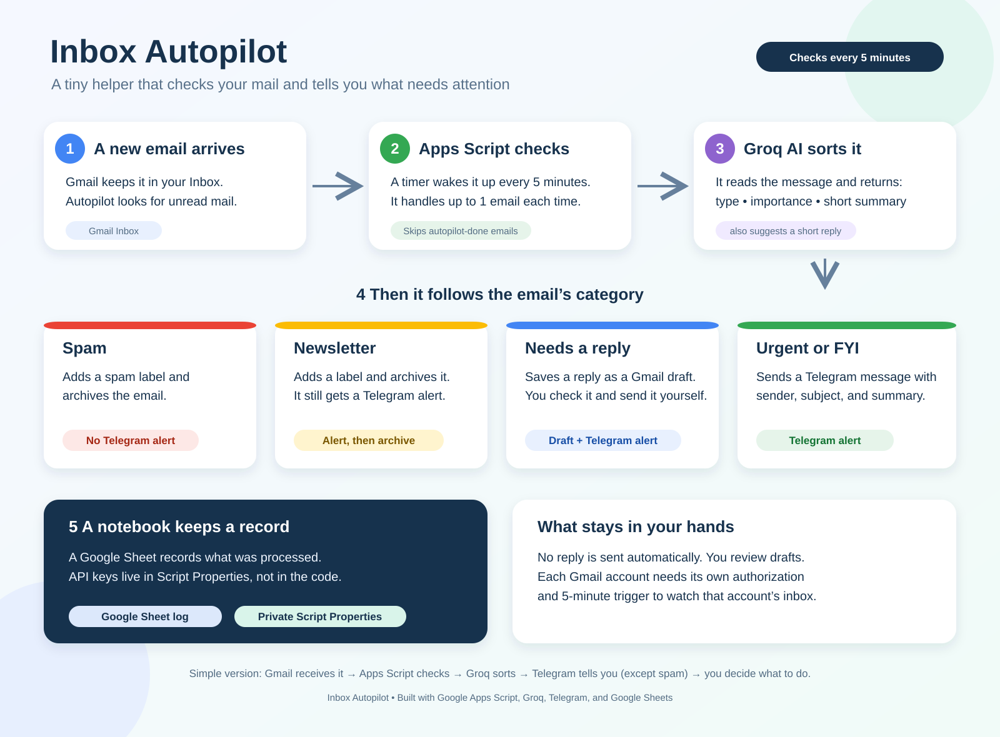

# Inbox Autopilot

A small email helper built with **Google Apps Script, Gmail, Groq, Telegram, and Google Sheets**. It checks unread inbox mail on a timer, asks an AI model to sort each message, alerts you in Telegram, and saves suggested replies as drafts for you to review.



## How it works

1. A time-driven Apps Script trigger wakes up every 5 minutes.
2. The script looks for unread threads in the Gmail account that created the trigger. It skips threads labeled `autopilot-done` and processes up to one thread per run.
3. It sends the email text to Groq and asks for a structured result: category, priority, a one-line summary, and a suggested reply.
4. It acts on that result:

| Category | What happens |
| --- | --- |
| `spam` | Gets a label and is archived. No Telegram alert. |
| `newsletter` | Gets a label and is archived; the current setup also sends a Telegram alert. |
| `needs_reply` | A suggested reply is saved as a Gmail draft; Telegram also gets an alert. |
| `urgent` / `FYI` | Telegram gets an alert with sender, subject, category, priority, and summary. |

5. A Google Sheet keeps a processing log. API credentials are read from Apps Script **Script Properties**, not hard-coded in the source.

## Simple architecture

```text
Gmail unread inbox
       ↓ every 5 minutes
Google Apps Script ── email text ──> Groq AI
       ↑                                ↓ JSON category, priority, summary, draft
       └──── Gmail labels / archive / drafts
                                        ↓
                               Telegram alert (except spam)
                                        ↓
                               Google Sheets log
```

## Setup summary

- Create or open the Apps Script project and add the source as `Code.gs`.
- In **Project Settings → Script properties**, set `GROQ_API_KEY`, `TELEGRAM_BOT_TOKEN`, and `TELEGRAM_CHAT_ID`. `LOG_SPREADSHEET_ID` is optional; the script can create a log spreadsheet for the account if needed.
- Run the setup function once, authorize the requested Google access, and confirm a time-driven trigger exists for `runInboxAutopilot` every 5 minutes.
- Test with one unread email. Check the Apps Script **Executions** page, the Telegram chat, and the Google Sheet log.
- For another Gmail account, authorize the project and create a trigger while signed into that account too. Triggers run as the account that created them.

## Upgrade levels included in this version

- **Level 1 — Inbox Shield:** completed mail gets a done label. If processing fails, the email gets a review label so the timer does not repeat the same failure every five minutes. Check `autopilot-review` manually.
- **Level 2 — VIP Priority:** optional comma-separated `VIP_SENDERS` or `VIP_SUBJECT_KEYWORDS` properties. Matches get a VIP label and a highlighted Telegram alert.
- **Level 3 — Telegram Control Room:** send `/pause`, `/resume`, or `/today` to the bot. Commands are checked by the timer, so replies can take up to five minutes. For a group chat, set `TELEGRAM_ADMIN_USER_ID` to authorize the sender.
- **Level 4 — Thread Context:** optional and off by default. Set `THREAD_CONTEXT_ENABLED` to `true` only if you want up to three earlier messages (up to 1,800 characters total) included in Groq's prompt.

Groq classification uses strict JSON Schema output for the supported `openai/gpt-oss-20b` model. If Groq reports a JSON validation error anyway, the script makes one prompt-only JSON recovery call and still validates/parses the result before taking any Gmail action.

Telegram alerts use the detailed, scannable format: category and priority first, then subject, sender, summary, and a category-specific next step. VIP emails also show a star marker.
## Important behavior

- Only one thread is processed per timer run, to keep each run small and reduce API rate-limit problems.
- Spam is excluded from Telegram. Other categories are sent to Telegram under the current configuration.
- Suggested replies are drafts. A person reviews and sends them.
- If a message has already been labeled `autopilot-done`, later runs skip it.
- Free quotas and API limits can change. Check the Groq and Google account limits you have available.

## Review the source code

The repository includes a complete `Code.gs` implementation of the described workflow. It is a clean implementation based on the configured behavior, not a byte-for-byte export of your live editor. Compare it with the live Apps Script editor before replacing deployed source. Before publishing, check that no actual API key, Telegram bot token, chat ID, spreadsheet ID, personal email contents, or other private data appears in the file. Keep credentials in Apps Script Script Properties.

Suggested repository contents:

```text
inbox-autopilot/
├── Code.gs
├── README.md
├── inbox-autopilot-overview.svg
└── .gitignore
```

## Add it to your GitHub profile

1. Sign in to GitHub and create a repository named `inbox-autopilot`.
2. Choose **Public** only if you want anyone to see the code. Never upload API keys or private email data.
3. Add `README.md`, `inbox-autopilot-overview.svg`, `.gitignore`, and the reviewed `Code.gs`.
4. On your GitHub profile, open **Repositories → Customize your pins** and pin `inbox-autopilot`.
5. You can also add the repository link to your profile README under a “Projects” heading.

## Security checklist before publishing

- Search the files for actual key values (for example, a Groq key beginning with `gsk_`), the Telegram bot token, the chat ID value, and your spreadsheet ID. Property names such as `TELEGRAM_BOT_TOKEN` are safe; their values must stay private.
- Keep actual credentials only in Apps Script Script Properties.
- Do not upload real emails, execution logs containing private content, or a downloaded copy of the log sheet.
- If a key was ever committed publicly, revoke it at its provider and create a replacement.

## Current project note

This README describes the configured workflow. Keep the repository source synchronized with Apps Script whenever you change the live code.


